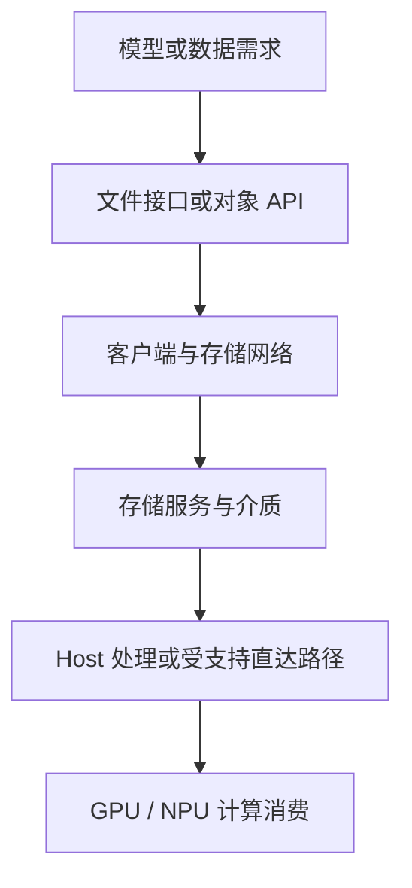

# OceanStor AI 存储学习路线

AI 存储服务于模型加载、持续供数、Checkpoint 和推理缓存。理解它，需要同时看清存储设备的组成、应用使用的接口，以及数据从存储到 CPU/GPU/NPU 的实际路径。

本模块介绍华为 OceanStor A800/A600，并与已有 NFS、Ceph、对象存储和 NVIDIA GPUDirect Storage 文章关联。这里的 A800/A600 指华为存储产品，不能与加速卡、Atlas 整机或 CUDA/CANN 混为一层。

## 1. 把产品与技术放在不同层次

| 层次 | 例子 | 回答的问题 |
| --- | --- | --- |
| 介质与设备 | NVMe SSD、控制器、网口、电源 | 数据存在哪里，谁管理和搬运 |
| 存储系统 | OceanStor A800/A600 | 怎样提供共享、保护、容量与性能 |
| 访问接口 | 文件、对象或目标产品支持的其他接口 | 应用怎样命名和访问数据 |
| 客户端与网络 | NFS 客户端、DataTurbo、TCP/RDMA | 请求与数据怎样到达存储 |
| 计算侧加速 | 相应 NDS/GDS 路径 | 怎样减少特定搬运开销 |
| 应用与缓存 | DataLoader、Checkpoint、UCM 等 | 应用何时访问什么，哪些结果可以复用 |

这些不是互斥产品清单。一台存储可以通过不同接口服务多个负载；一个应用也可能组合长期对象存储、共享文件与节点缓存。NVIDIA GDS 是计算侧软件和数据路径技术，不是一台与 A800 对应的存储阵列。

## 2. 读懂一次完整访问

这是职责链，不是精确布线图，也不是所有数据必须先后经过每一层缓存。普通模型加载可能先在 CPU 解析格式，再搬入设备；受支持的直接路径可以减少部分 Host 中转；缓存命中则可能根本没有访问远端存储。

分析时记录五个对象：应用与模型版本、访问接口、目标文件/对象、客户端与挂载身份、实际设备与网络路径。只写“存储很快”不能说明某个请求经过了哪里。

## 3. 四类负载怎样提出不同要求

| 负载 | 主要数据 | 重点问题 |
| --- | --- | --- |
| 模型加载 | 权重分片、配置、Tokenizer | 并发冷启动、解析、校验和 H2D |
| 训练供数 | 样本、索引和数据分片 | 元数据、随机读、预取与 CPU 解码 |
| Checkpoint | 参数、优化器与运行状态 | 突发写入、完整发布、持久性和恢复 |
| 推理缓存 | 可复用的 KV 等中间状态 | 命中、格式兼容、回填、租户隔离与失效 |

上述负载可能同时争用相同存储资源。训练顺序读的聚合带宽高，不代表小文件打开、Checkpoint 提交或低延迟 KV 回填也都足够快。

## 4. A800 与 A600 应怎样比较

以 2026 年 11 月核对的公开产品页面为参考，A800 使用 8U 双节点形态，A600 使用 2U 双节点形态。它们都应继续拆成控制器、内存、SSD、网络与软件特性来理解，不能仅凭机箱高度判断单客户端速度。

| 对比维度 | 应保存的口径 |
| --- | --- |
| 物理形态 | 每框、每节点、每控制器的数量分别记录 |
| 容量 | 裸容量、数据保护开销、保留空间和业务可用量 |
| 性能 | 单客户端、整框、集群，以及冷读/热读和负载条件 |
| 接口 | 协议版本、客户端、许可、启用状态和兼容范围 |
| 故障行为 | 降级、重建、切换、缓存丢失与恢复时的表现 |

公开页面是产品参考，不是某台已交付设备的完整清单。硬件修订、软件版本和可选功能应关联实际设备与配套资料；不能把不同年代、地区或测试条件的最大值组合为一个“理想型号”。

## 5. 容量、带宽与持久性各自回答什么

容量说明能保存多少数据；带宽说明特定条件下传输多快；持久性说明故障后哪些数据仍能恢复。三者没有一个可以代替另外两个。

例如，某块缓存盘能很快接收数据，只说明该阶段完成得快。如果权威共享副本尚未提交，节点故障仍可能丢掉最近一次 Checkpoint。反过来，存储具备冗余，也不保证误删除、错误发布和跨故障域灾难都可恢复。

同样，100 Gb/s 端口的线速换算是约 12.5 GB/s，尚未扣协议等开销；不能用整框聚合的数百 GB/s 直接代替这个客户端端口的能力。还要检查端口数量、共享路径、服务器处理和数据来源。

## 6. 学习顺序与文章分工

| 顺序 | 文章 | 重点 |
| --- | --- | --- |
| 1 | [AI 工作负载 I/O 模型](../ai-workloads/01-AI工作负载的存储IO模型.md) | 先定义读写与恢复需求，再算容量和并发 |
| 2 | [OceanStor A800 架构](./01-OceanStor-A800架构与AI数据路径.md) | 数控分离、数据面卸载与整框/集群边界 |
| 3 | [OceanStor A600 架构](./02-OceanStor-A600架构与AI数据路径.md) | 紧凑形态、客户端协作与推理缓存 |
| 4 | [协议与客户端数据路径](./03-OceanStor-AI存储协议客户端与数据路径.md) | 文件、对象、DataTurbo、NDS 与容器挂载 |
| 5 | [NVIDIA GDS](../ai-workloads/02-GPUDirect-Storage原理与实践.md) | cuFile、直接路径、兼容回退与实际验证 |

文件接口基础回到 [NFS](../nfs/00-NFS学习路线.md)、[Ceph](../ceph/00-Ceph学习路线.md)和 [对象存储](../ai-workloads/04-对象存储与模型仓库设计.md)；计算整机与 NUMA 则进入 [AI 服务器产品体系](../../gpu/servers/00-AI服务器产品体系与整机学习路线.md)。不同模块通过同一次数据访问关联，不需要复制一套协议基础。

## 7. 练习与答案

**问题一：OceanStor、NFS、DataTurbo 和 GDS 是否是同一层的四种存储？**

答案：不是。它们分别涉及存储产品、文件访问协议、客户端/文件加速和设备数据路径；选型需要先确认作用层次，而不是简单四选一。

**问题二：整框带宽高，为什么一个 100 Gb/s 客户端不一定更快？**

答案：整框聚合与单端口不是同一范围。单个端口线速约 12.5 GB/s，还受协议、共享链路、客户端与应用处理约束。

**问题三：Checkpoint 已写入本地缓存，是否证明可以断电后恢复？**

答案：不能。还要确认所需数据已经按持久化与发布协议提交到可恢复位置，本地临时确认不等于完成权威副本提交。

**问题四：同一文件第二次加载更快，是否证明存储阵列升级有效？**

答案：不能单凭这个现象。节点缓存、Page Cache、服务端缓存和已编译状态都可能变化，需要控制缓存条件并观察各层实际流量。

## 8. 官方参考

- [OceanStor A800 产品与规格](https://e.huawei.com/cn/products/storage/ai-storage/oceanstor-a800)
- [OceanStor A600 产品与规格](https://e.huawei.com/cn/products/storage/ai-storage/oceanstor-a600)
- [华为 AI 推理加速方案与 UCM](https://e.huawei.com/cn/solutions/storage/ai-storage/ai-inference-acceleration)
- [NVIDIA GDS 文档](https://docs.nvidia.com/gpudirect-storage/)
