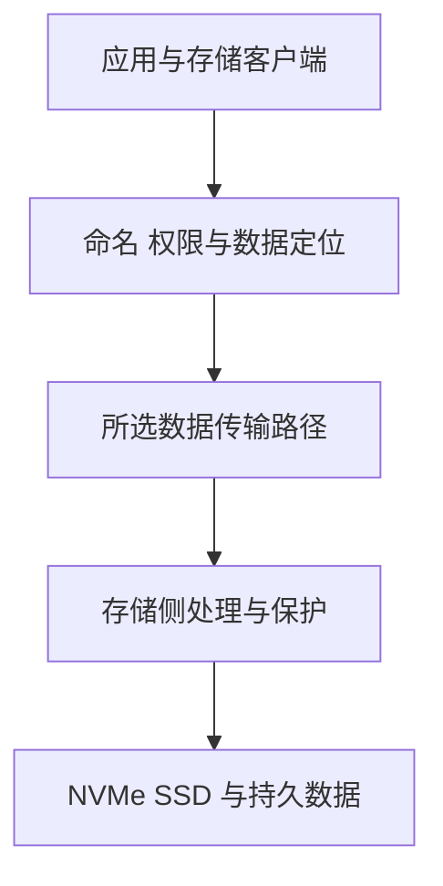

# OceanStor A800 架构与 AI 数据路径

OceanStor A800 是面向 AI 的分布式文件存储系统，不是 GPU 服务器外接了一组 SSD。存储节点需要处理命名、权限、数据定位、并发、保护、网络与介质访问；应用看到一个文件路径，背后可能经过多类组件。

本文硬件表以 2026 年 11 月核对的 [A800 公开产品页面](https://e.huawei.com/cn/products/storage/ai-storage/oceanstor-a800)为基线，架构特性结合公开彩页解释。图示是职责模型，不表示完整板级连线、实际 DPU 数量或某台交付设备的端口映射。

## 1. 先读清每框与每节点

| 项目 | 产品页参考值 | 对学习的意义 |
| --- | --- | --- |
| 机箱形态 | 8U、双节点 | 机箱、节点和集群不是一个粒度 |
| CPU | 每节点四颗 | 承担控制、管理与相应数据处理，不是训练 GPU |
| 内存 | 每节点 1024 GB | 存储节点内存，不是计算节点 HBM |
| SSD | 每框最多 64 块 | 实际数量与单盘容量决定裸容量起点 |
| 网络 | ETH、RoCE、IB 的不同参考规格 | 需按网络类型、接口和软件配套选择 |

产品页列有节点扩展字段，特性文案还使用控制器口径。规划时应使用目标产品版本的节点/控制器定义和配置清单，不从名称自行推导框数或将多个扩展上限相乘。

“盘控一体”描述硬件集成形态；“数控分离”描述控制和数据处理职责划分。两者并不矛盾：逻辑职责可以分离，而 SSD 与控制器仍位于同一框中。

## 2. 数控分离到底分离什么

控制职责关心对象身份、权限、数据布局、状态和集群协作；数据职责关心实际字节的搬运与处理。具体操作可能涉及二者，但没必要把每个字节都按同一通用控制流程逐级转发。



这是一次访问的职责顺序，不表示每个读请求都重新完成所有元数据查询，也不表示控制面与数据面必须串联经过同一颗 CPU。缓存、授权状态和实际客户端会改变交互次数。

公开资料介绍了 DPU 等数据面卸载：其意义是将相应数据处理从通用 CPU 路径中分担出去，不是存储不再需要 CPU、内存、元数据或故障管理。要判断一次读是否使用卸载，仍需客户端、功能配置与实际统计，而非只看“有 DPU”。

## 3. 一次模型权重读取

计算节点首先需要找到正确的模型版本和文件，并获得访问权限；客户端根据所用协议与布局读取数据。字节到达计算节点之后，应用还可能进行校验、反序列化、精度或布局处理，再搬到 GPU/NPU。

```text
模型版本与文件范围
→ 客户端定位和读取
→ 存储网络及存储侧数据路径
→ Host 处理或已适配的直接搬运
→ 框架设备分配与模型初始化
```

这解释了为什么存储带宽上升，模型 Ready 时间不一定同比下降。如果 CPU 格式处理与图准备占主导，优化纯读时间只能改善其中一部分。

DataTurbo 在公开资料中是高性能文件加速引擎；它与普通 NFS、应用文件格式以及 NDS/GDS 的职责不同。使用了 DataTurbo，不应直接推断“数据已经直接进入任意设备 HBM”。客户端细节见 [协议与数据路径](./03-OceanStor-AI存储协议客户端与数据路径.md)。

## 4. 分布式扩展为什么不等于任意客户端线性提速

增加节点可能增加介质、处理与网络资源，但共享上行、元数据热点、单文件布局、客户端并发和锁仍可能限制实际速度。Scale-out 是扩展方式，不是每增加一框都保证每个请求等比例加速。

假设某个客户端只使用一个 100 Gb/s 端口，线速换算约为 12.5 GB/s。即使某整框宣传口径达到数百 GB/s，这个客户端仍不能通过该单端口独享整框聚合能力；协议与应用开销还会降低有效值。

同一理由也适用于多客户端：先按端点、方向和实际并发合计，再检查共同链路，而不是把服务器、交换机和存储的所有端口铭牌相加。

## 5. 容量必须从裸容量继续往下算

做一个**自设盘容量的教学预算**：假设装满 64 块 15.36 TB SSD，则裸容量是 `64 × 15.36 = 983.04 TB`。这里不代表实际订单都采用这种单盘容量。

若再假设数据保护后的有效比例为 0.75，另保留 20% 运行余量，预算约为：

```text
983.04 TB × 0.75 × 0.80 = 589.824 TB
```

0.75 和 20% 都是解释公式的假设，不是 A800 的固定编码效率或厂商推荐阈值。实际还要确认保护策略、元数据、系统保留、快照、数据变化、容量单位及恢复空间。压缩或去重也不能在未测数据上当作保证可用的容量。

存储节点内存不是长期业务容量；计算节点 HBM 更不由这组 SSD 容量自动扩展。各层缓存和持久数据应分别记账。

## 6. Checkpoint 怎样才算可恢复

Checkpoint 包含多个 Rank 的状态。所有分片都写完，不等于训练已经知道它们构成同一次完整保存；发布与恢复需要知道版本、分片集合及完成状态。

通用设计可以把“写数据”“确认所需持久性”“发布完整清单”分开。临时文件改名只提供相应文件系统里的命名操作语义，不自动替代数据同步、跨分片协调和故障后恢复验证。

高可用、数据冗余与备份也不是同义词。单组件故障后服务继续访问，不代表误删除或错误覆盖可以撤回。需要恢复到什么时间点、在哪种故障后可用，应由业务数据保护方案单独覆盖。

## 7. 推理缓存不是把 SSD 当作透明 HBM

A800 公开资料介绍 Unified Cache 等推理加速能力；其核心需要计算框架、缓存管理与存储协同，而不是只在服务器挂载一个目录。

需要复用的 KV 与模型版本、Token 前缀、位置、布局、精度及并行划分等有关。这里列的是缓存正确性的通用约束，不是公开资料之外的厂商私有 Key 格式。跨租户复用还要满足隔离要求。

缓存命中后仍可能发生读取、回填和重排。是否比重算更划算，需要比较命中率、回填耗时、计算节省与尾延迟；产品页的相对提升不能代替当前模型和流量的基准。

## 8. 把性能下降定位到哪种职责

| 现象 | 优先证据 |
| --- | --- |
| 大文件快，小文件启动慢 | 元数据、目录热点、客户端往返与样本组织 |
| 少量节点快，扩容后变慢 | 聚合需求、共享网络、缓存与服务端热点 |
| 设备吞吐高，训练仍等待 | DataLoader、CPU 解码、H2D 与慢 Rank |
| Checkpoint 写完却不能恢复 | 分片一致性、清单发布、持久性与恢复流程 |
| KV 命中率高，TTFT 仍差 | 有效命中、回填、重排、排队和跨域路径 |

收集证据时关联存储软件版本、客户端、挂载、文件/对象范围与相同时间窗口。阵列级平均值与单个应用的 P99 不应互相替代。

## 9. 练习与答案

**问题一：盘控一体与数控分离是否互相矛盾？**

答案：不矛盾。前者描述硬件集成，后者描述控制与数据职责；逻辑分工不要求部件一定分装在不同机箱。

**问题二：一台存储有两节点，是否说明任意单客户端速度会翻倍？**

答案：不能。客户端网口、并发、数据布局与共享链路可能先成为瓶颈，需要在同一范围测量有效吞吐。

**问题三：示例 983.04 TB 能否直接全部交给业务？**

答案：不能。它只是给定盘数与容量下的裸容量，数据保护、元数据、系统和运行余量等还要继续扣算，且示例比例不代表产品固定配置。

**问题四：开启推理缓存是否会透明扩大单个 Tensor 可分配的 HBM？**

答案：不会自动发生。分层缓存需要软件协议、正确性和搬运管理；存储容量与设备分配空间是不同层次。

## 10. 官方参考与延伸阅读

- [OceanStor A800 产品规格与架构特性](https://e.huawei.com/cn/products/storage/ai-storage/oceanstor-a800)
- [OceanStor A800 公开彩页](https://e.huawei.com/marketingcloud/pep/asset/20000001/Material/2f78b7174b104282ade8eec2f870b8ea/M3T1A590N1184518135321755785/%E5%8D%8E%E4%B8%BAOceanStor%20A800%20%E5%AD%98%E5%82%A8%E5%BD%A9%E9%A1%B5.pdf)
- [UCM 推理协同方案](https://e.huawei.com/cn/solutions/storage/ai-storage/ai-inference-acceleration)
- [AI 工作负载 I/O 模型](../ai-workloads/01-AI工作负载的存储IO模型.md)
- [OceanStor A600 架构](./02-OceanStor-A600架构与AI数据路径.md)
