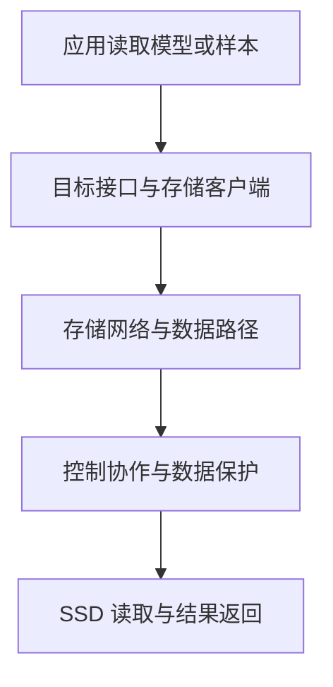

# OceanStor A600 架构与 AI 数据路径

OceanStor A600 是紧凑形态的高性能 AI 存储。理解它不能只做“A800 缩小版”的类比：机箱、盘数、内存、网口、扩展和功能配套都需要按目标产品核对，应用的数据路径则要继续追到客户端与计算框架。

硬件参考值采用 2026 年 11 月核对的 [A600 中文产品页](https://e.huawei.com/cn/products/storage/ai-storage/oceanstor-a600)。DataTurbo、NDS 与缓存能力结合公开彩页和解决方案说明解释，不把某项特性当作所有交付配置已启用。

## 1. 双节点形态里包含什么

| 项目 | 产品页参考值 | 应怎样理解 |
| --- | --- | --- |
| 机箱 | 2U | 存储系统高度，不是加速器数量 |
| 节点 | 每框两节点 | 节点、控制器与整套集群应分别计数 |
| SSD | 每框最多 36 块 | 最大槽位不代表已经满配 |
| 内存 | 每节点 512 GB | 属于存储节点，不会直接出现在计算节点可用 HBM 中 |
| 网络 | ETH 与 RoCE 的多档规格 | 端口数、速率和选配条件需要实际配置证明 |

产品页的 RoCE 200 Gb/s 档带有星号限定，不能去掉条件后写成每台机器都可直接使用。扩展上限也属于整套系统口径，不是每个现有节点的实际负载能力。

一个重要的资料差异是：旧公开彩页出现单框 160 GB/s，而当前中文网页写 220 GB/s。它们不能脱离资料与配置范围混合，更不能自行认定差异一定来自某块新网卡。性能规划应固定硬件、软件和统计范围，再在目标负载下验证。

## 2. 客户端、控制职责与数据职责

应用发起文件或对象访问；客户端处理相应接口、定位与数据请求；存储系统再完成权限、元数据、数据保护和介质访问。控制与数据职责分离的目的，是减少不必要的数据处理串行化，而不是把全部控制逻辑删除。



图是角色模型，不规定报文必须先穿过某个物理控制器才到盘。客户端缓存、数据布局和协议决定具体交互；“双节点”也不能被解释为每次读一定做两次完整复制。

单节点、链路或盘故障后是否还能访问，以及切换期间多久恢复，需要结合实际保护和高可用配置。两节点这个数量本身不是 RPO、RTO 或全部故障隔离能力的证明。

## 3. DataTurbo、NDS 和 UCM 优化的是不同环节

| 名称 | 公开资料中的职责 | 不应直接推断 |
| --- | --- | --- |
| DataTurbo | 高性能文件加速引擎，优化相应客户端访问与数据流动 | 任意应用已绕过 Host 内存 |
| NDS | 构建与 NPU 协作的存储数据路径 | CUDA/GDS 二进制可直接用于 NPU |
| UCM | 协同推理框架、计算和存储管理推理缓存 | 只挂载目录就自动共享全部 KV |

例如，客户端文件读取更快，改善的是访问开销与数据供应；NDS 还涉及计算侧软件与设备搬运；UCM 则需要知道哪些推理状态可以复用。三个名字不能互换，也不能只因存储支持某项特性，就宣布应用已经使用了它。

具体协议、版本与挂载关系见 [OceanStor 客户端数据路径](./03-OceanStor-AI存储协议客户端与数据路径.md)。NVIDIA 环境另按 [GDS 支持与验证](../ai-workloads/02-GPUDirect-Storage原理与实践.md)处理，不根据品牌或 RoCE 网口推断认证关系。

## 4. 两种读取不能用同一个公式解释

模型初次加载往往需要读权重，再解析、创建 Tensor 和进行设备初始化。推理 KV 回填则处理已有计算状态，关注命中、读取粒度、恢复到目标布局与调度时机。

| 对比 | 模型权重 | 推理 KV |
| --- | --- | --- |
| 典型身份 | 模型版本、权重分片 | 模型、Token 前缀及相关执行条件 |
| 生命周期 | 长期相对稳定 | 随请求、缓存策略和版本变化 |
| 正确性 | 权重内容与格式完整 | 还要满足位置、布局、精度和并行等复用约束 |
| 主要收益 | 避免重复下载、缩短加载 | 避免相应重复计算，但要支付回填开销 |

这些是通用的应用分析维度，不是对 UCM 私有存储格式的描述。向量检索、权重读取和 KV 复用也是三种不同语义；同一个存储系统承载它们，不意味着可以使用同一个对象标识与一致性规则。

## 5. 分层 KV 缓存为什么既可能提速，也可能拖慢

HBM、Host DRAM 和 SSD 分层，让一部分可复用状态不必全部常驻昂贵设备内存。但命中后还需要找到数据、读取、搬运并恢复到框架可消费状态。

以一个**不考虑重叠的教学时延模型**说明：假设重新计算所需 120 ms；一次有效缓存命中需要检索 5 ms、读取与搬运 25 ms、整理 10 ms，则回填成本为 40 ms，比重算少 80 ms。若另一类短请求本来只需 20 ms 重算，同样的 40 ms 回填可能反而不划算。

```text
示例命中收益 = 重算成本 − 检索、回填与整理成本
```

这不是产品性能实测，也没有包含排队、预取、命中失败及网络竞争。真实系统必须分请求类别测 TTFT/TPOT 与尾延迟，不能仅优化“命中率”一个数字。

容量与正确性同样重要。SSD 上有大量可复用 KV，不表示某个 Kernel 能透明寻址全部 SSD；框架需要明确的数据迁移与调度协议。跨模型、跨版本或跨租户的错误复用，会把性能优化变成结果或数据隔离问题。

## 6. 多种计算节点共用存储时要分开哪些东西

NVIDIA GPU 与昇腾 NPU 节点可以在受支持接口上消费同一份版本化数据，但客户端、Driver、Runtime、Kernel、图与编译缓存仍有自己的配套要求。

原始样本与可移植权重可以按身份管理；设备相关的编译产物、布局与 KV 不能只凭文件名相同就互换。共享存储负责提供数据，不替计算框架完成硬件适配。

同时要避免把权重分发、训练数据、Checkpoint 与在线 KV 全放进一个无限竞争的队列。分析可按业务类别关联流量、配额、QoS、延迟与错误，再确认目标产品版本支持怎样的隔离和调优。

## 7. 两节点健康不等于应用路径健康

| 检查对象 | 能说明什么 | 尚未覆盖 |
| --- | --- | --- |
| 存储硬件摘要 | 部分部件与环境状态 | 具体挂载、权限及客户端路径 |
| 文件读取成功 | 这次接口请求可完成 | 加速路径和多客户端性能 |
| 存储吞吐高 | 对应统计范围数据在流动 | 单请求尾延迟与有效样本供应 |
| 缓存命中高 | 相关计数记录了命中 | 正确复用、回填成本与业务净收益 |

排障时对齐时间、版本、路径和应用范围。不要因某个总览面板为绿，就跳过客户端、Host CPU、网络与框架观察。

## 8. 练习与答案

**问题一：A600 每节点 512 GB 内存是否自动增加计算节点的显存？**

答案：不会。存储节点内存属于另一个系统；缓存与数据搬运需要相应软件协同，不是自动合并成单设备 HBM。

**问题二：使用 DataTurbo，是否证明已使用 NDS 或 UCM？**

答案：不能。它们分别优化文件访问、NPU 数据路径与推理缓存协同，需要各自的配套、启用与实际使用证据。

**问题三：示例中 40 ms 回填是否总比重算好？**

答案：不是。对 120 ms 重算的请求可能有收益，对只需 20 ms 的请求则可能更慢；还需计入排队、失败、并发与重叠。

**问题四：旧彩页与当前网页的带宽不同，能否取较高值作为所有设备验收标准？**

答案：不能。应固定配置、软件、负载和统计范围，核对相应资料。产品参考上限不等于每台现有设备或每个客户端的保证值。

## 9. 官方参考与延伸阅读

- [OceanStor A600 当前中文产品页](https://e.huawei.com/cn/products/storage/ai-storage/oceanstor-a600)
- [OceanStor A600 公开彩页与 DataTurbo/NDS](https://e.huawei.com/marketingcloud/pep/asset/20000001/Material/a0faebc462144048b273ba8f1332fb4a/M3T1A590N1206173257300062303/Huawei%20OceanStor%20A600%20Storage%20Data%20Sheet.pdf)
- [UCM 与推理分层缓存](https://e.huawei.com/cn/solutions/storage/ai-storage/ai-inference-acceleration)
- [OceanStor A800 架构](./01-OceanStor-A800架构与AI数据路径.md)
- [NPU 计算与 CANN 软件栈](../../gpu/ascend-npu/04-CANN软件栈组件与计算调用链.md)
