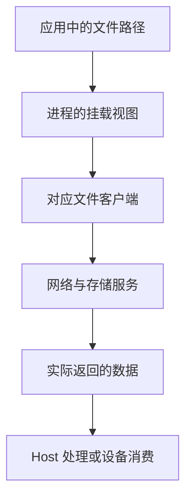

# OceanStor AI 存储协议与客户端数据路径

同一台存储、同一个目录名，不代表使用同一种协议或相同数据路径。应用可能通过标准文件客户端、厂商加速客户端、对象 SDK 或已经适配的设备直达接口访问；每种方式的兼容、权限和性能证据都不同。

本篇以 OceanStor A800/A600 为讨论对象，解释如何识别路径，不提供未经目标版本验证的挂载、内核模块或 CSI 安装命令。具体协议版本、功能和许可以实际产品配套为准。

## 1. 先分接口、客户端与传输

| 层次 | 例子 | 不能直接推断 |
| --- | --- | --- |
| 应用语义 | 文件读写、对象 GET、缓存读取 | 已采用哪一种底层网络 |
| 客户端实现 | NFS 客户端、DataTurbo、SDK | 全部 POSIX 语义或版本都相同 |
| 网络传输 | TCP、受支持的 RDMA 路径 | 数据已经绕过 CPU 内存 |
| 计算侧处理 | CPU 解析、H2D、NDS/GDS 等适配 | 文件读取成功就等于直达设备 |

POSIX 是接口语义体系，不是某根线上的网络协议。NFS 是文件共享协议；RDMA 是数据传输能力；DataTurbo 是文件加速引擎。它们可以在不同层组合，不能按名称直接互相替换。

其他 OceanStor 系列资料中的 DPC 等客户端也有自己的适用产品和版本。不能因同属一个品牌，就将 Pacific 或 Dorado 的客户端、NFS 版本表和功能限制当作 A800/A600 的配套清单。

## 2. 一次文件访问分成哪些环节



挂载完成只解决其中一部分。数据格式处理和设备搬运仍可能留在应用层；CSI 也通常不在每个数据包的实时转发链中。

需要分别记录元数据与数据操作。例如 `stat/open` 慢而大文件流式读快，可能更接近目录、权限、客户端往返或元数据热点，不应只扩大顺序读块大小。

## 3. 用挂载信息确认访问入口

Linux 上可先查询已有目标路径，`/mnt/models` 按实际替换：

```bash
findmnt -T /mnt/models -o TARGET,SOURCE,FSTYPE,OPTIONS
```

假设某环境使用 NFS，教学节选可能是：

```text
TARGET      SOURCE                  FSTYPE OPTIONS
/mnt/models 192.0.2.40:/models       nfs4   rw,relatime,vers=4.1,proto=tcp
```

`192.0.2.40` 是文档示例地址，不是测试目标。该记录说明所选路径在这个进程视图里由一个 NFSv4.1/TCP 挂载承载，**不说明 A800/A600 所有接口都固定如此，也不证明正在使用 RDMA 或 NDS/GDS**。

`findmnt -T` 可能返回包含目标的上级挂载；若挂载未成功，甚至可能看到根文件系统。因此还要核对 SOURCE 和 TARGET，而不只是命令返回了成功状态。

对于实际 NFS 挂载且已安装工具的环境，可以继续看：

```bash
nfsstat -m
```

若当前使用厂商专用客户端，应查询该客户端和目标版本的工具，不拿 NFS 命令的空结果证明它一定坏了。

## 4. DataTurbo 的加速不等于所有语义都没有代价

公开产品资料描述 DataTurbo 的文件加速及相应内核态数据路径。应用仍需要正确的文件身份、权限与客户端配置；客户端的 OS/Kernel、存储软件和容器接入需要配套。

尤其要分开检查缓存一致性、锁、并发写、原子改名与持久性。上层调用还是 `read()`，不代表另一种客户端对每种场景都具有完全相同的行为或性能。

如果产品支持多协议访问相同数据，还需确认身份映射、名称映射、缓存可见性与并发更新约束。不要把“统一命名空间”理解为任意协议客户端之间都能立即看到所有变化。

## 5. 文件与对象访问不能只换路径

文件接口组织目录、文件句柄、偏移和相应锁；对象接口围绕 Bucket/Key、请求、版本及对象范围操作。对象 Key 中包含斜杠，并不意味着它就是一个普通文件系统目录。

即使底层产品具备多协议互通能力，应用也要核对受支持的映射规则和启用条件。POSIX 原子 `rename` 不能一概翻译成对象“复制再删除”；成功的 GET 也不能替代一个完整模型版本的所有分片校验。

模型发布可以使用不可变版本、分片清单和完整性校验；Checkpoint 则需要数据集齐和持久提交。具体机制应按接口设计，而不是假设所有共享路径都拥有同一协议语义。

## 6. 存储网络与设备直达要分别证明

在拥有相应权限和工具的 Linux 环境中，以下查询用于关联可见接口与 RDMA 链路，不修改网络：

```bash
ip -br link
rdma link show
lspci -tv
```

链路 Up 只说明部分链路状态，不证明应用选中了它。Host 业务网、存储网、设备计算网与带外管理网可能不同，HCCL/NCCL 测试通过也不能代替存储数据路径验证。

NDS 与 NVIDIA GDS 分属不同设备生态和软件配套。A 系列公开资料介绍 NDS，不等于该配置自动获得 NVIDIA GDS 的所有文件系统支持；RoCE 端口存在，也不等于应用 `open/read` 已绕过 Host 中转。

应分三项确认：接口能完成请求；所期待的路径确实被采用；真实应用在正确性和 SLO 下获益。前两项都满足，仍可能因为解码、反序列化和排队而没有明显端到端收益。

## 7. 容器与 Kubernetes 为什么还会看到不同结果

Host 已挂载目录，不保证它已经正确进入目标容器。挂载命名空间、Bind Mount、只读标志、用户权限和 CSI Node 发布结果都需要逐层核对。

在 Kubernetes 中可以先关联已有资源：

```bash
kubectl get pod model-server -n inference -o wide
kubectl get pvc model-data -n inference -o wide
kubectl describe pod model-server -n inference
```

示例对象名需要替换。Pod 已 Running，不代表目标路径包含正确模型版本；PVC Bound 也不代表所有节点的客户端与数据网络都可用。

CSI 负责相应存储生命周期与挂载协作，不自动安装任意厂商客户端、修复内核兼容、分配 RDMA/GPU 或保证加速路径。应核对目标产品支持的 CSI 驱动与能力，而不是编造一个通用的 Huawei Provisioner 名称。

权限错误也不应通过全局开放权限、取消根身份限制或将所有业务容器特权化来掩盖。先确认 UID/GID、服务端授权、映射和容器运行用户。

## 8. 一个路径证据记录应包含什么

```text
应用 / 模型版本 / 文件或对象范围
→ Pod、进程与实际节点
→ 挂载来源、客户端和访问接口
→ 存储软件、目标数据集与授权
→ 实际网络、缓存和设备搬运
→ 时间窗口、有效字节、错误与应用指标
```

记录中区分配置与实际行为。配置写了某协议，仍需确认最终生效；工具报告某项能力受支持，仍需实际请求统计；一个峰值结果不代替持续负载与故障后的可用性。

## 9. 练习与答案

**问题一：findmnt 显示 nfs4/proto=tcp，是否证明已经使用 NDS？**

答案：没有。它描述所查挂载的文件访问入口；设备直达需要另外的应用、客户端、计算与存储配套和实际路径证据。

**问题二：统一命名空间是否代表任意客户端协议完全等价？**

答案：不是。身份、缓存、锁、并发更新、名称映射和持久性仍有协议及产品约束，需要按支持规则验证。

**问题三：CSI 挂载成功，为什么还可能没有获得预期加速？**

答案：CSI 没有自动证明客户端、设备、网络和应用已经采用该路径。还要检查实际请求与计算侧集成，而非只看 PVC 状态。

**问题四：为什么不能把 OceanStor Pacific 的 DPC 安装说明直接套给 A600？**

答案：产品系列、存储软件和客户端的支持关系各有范围。同品牌和相似功能名称都不足以证明包、内核、协议和配置可以互换。

## 10. 参考与延伸阅读

- [OceanStor A800 产品与特性](https://e.huawei.com/cn/products/storage/ai-storage/oceanstor-a800)
- [OceanStor A600 产品与特性](https://e.huawei.com/cn/products/storage/ai-storage/oceanstor-a600)
- [OceanStor A600 DataTurbo/NDS 公开彩页](https://e.huawei.com/marketingcloud/pep/asset/20000001/Material/a0faebc462144048b273ba8f1332fb4a/M3T1A590N1206173257300062303/Huawei%20OceanStor%20A600%20Storage%20Data%20Sheet.pdf)
- [NFS 学习路线](../nfs/00-NFS学习路线.md)
- [对象存储与模型仓库](../ai-workloads/04-对象存储与模型仓库设计.md)
- [CSI 挂载链路](../ai-workloads/05-Kubernetes-CSI挂载链路与故障排查.md)
- [NVIDIA GDS 路径与支持范围](../ai-workloads/02-GPUDirect-Storage原理与实践.md)
